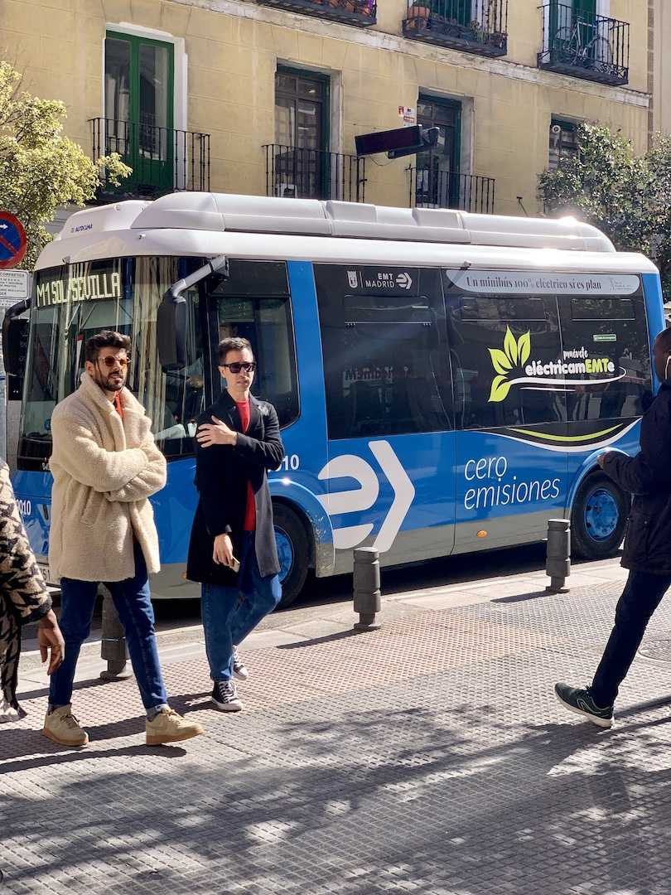
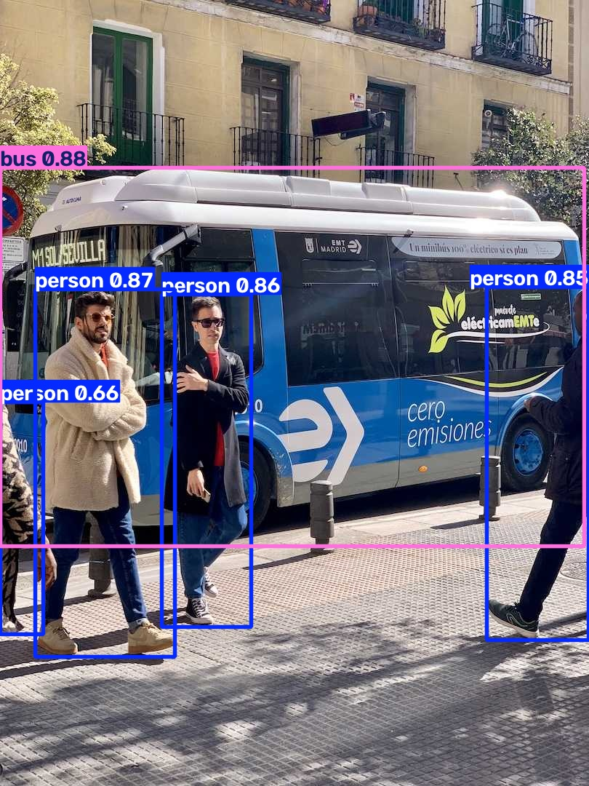

# T01：Quickstart 安裝與首次預測

**本次範圍已完成：新 uv 環境的 CLI、Python 圖片預測及新程序重跑均通過。** 發現兩項待查的教學／設定說明線索，尚未判定需要提出上游 PR。

回到 [全部已執行範例](../README.md)。下面先看三個案例的輸入、流程及結果，再往下查環境與問題細節。

<a id="t01-a"></a>

## T01-A：建立可執行教學的環境

**結果：安裝成功；匯出版本清單曾失敗一次，補回快取設定後成功。**

| 項目 | 本次實際內容 |
| --- | --- |
| 輸入 | uv 0.11.23、Python 3.13.14、PyPI 的 Ultralytics、CPU 版 PyTorch |
| 流程 | 建立 `.venv` → 安裝 41 個套件 → 確認 import 來源 → 設定專用目錄 → 匯出版本清單 |
| 執行方式 | 下方「1. 跑通結果」的 uv 指令；每一步成功後才執行下一步 |
| 預期輸出 | 可使用的 `python.exe` 和 `yolo.exe`，以及套件版本清單 |
| 實際輸出 | Ultralytics 8.4.191、torch 2.14.1+cpu；[完整套件清單](T01-assets/logs/requirements-resolved.txt) |
| 錯誤發生處 | 安裝之後的 `uv pip freeze`：未恢復 `UV_CACHE_DIR`，存取預設快取被拒，退出碼 1 |
| 如何處理 | 將 `UV_CACHE_DIR` 指向可寫入的 Temp 快取，重跑 freeze 成功 |
| 是否是 Ultralytics 缺陷 | 目前證據指向本機權限及程序設定，不是產品缺陷 |

[安裝完整日誌](T01-assets/logs/install.log) 中有 `NativeCommandError` 字樣，但安裝程序的退出碼為 0。它是 PowerShell 對 stderr 的呈現方式，不代表安裝失敗。freeze 的失敗訊息只保留於當時工具輸出，未另存原始日誌；上表為當次觀察紀錄。

<a id="t01-b"></a>

## T01-B：用命令列預測兩張內建圖片

**結果：成功輸出兩張標示圖，退出碼 0，首次執行共 28.07 秒。**

流程：下載 `yolo26n.pt` → 讀取套件內的 `bus.jpg` 和 `zidane.jpg` → 預測物件 → 畫出框與標籤 → 儲存圖片。

執行指令（使用本次環境的 `yolo.exe`）：

```powershell
& "$runRoot\.venv\Scripts\yolo.exe" predict model=yolo26n.pt
```

### 輸入與輸出放在一起看

| 輸入圖片 | 實際輸出圖片 |
| --- | --- |
|  |  |
|  |  |

框表示模型預測的物件位置；文字是類別，數字是信心分數。這些分數不是整體準確率，也不能單憑圖片證明所有框都正確。

原始輸出位置為 `$runRoot/runs/detect/predict/`。上方展示的是當次結果的副本，沒有重新生成或修改圖片。

### 哪裡有錯誤或困惑

| 發生位置 | 實際訊息或現象 | 是否阻塞 | 判斷與下一步 |
| --- | --- | --- | --- |
| 選擇輸入來源 | `WARNING 'source' argument is missing. Using default ...` | 否 | 官方最短指令就是省略 source；這次正常使用內建圖片。可評估是否需要解釋預期警告 |
| 首次下載模型 | 設定 weights_dir 後，檔案仍出現在工作目錄 | 否 | 路徑說明待查，留給 T05；尚未判成 bug |
| 預測與存圖 | 沒有執行錯誤，兩張圖片均存在 | 否 | 新程序重跑也成功，產生另一個輸出目錄 |

證據：[首次完整日誌](T01-assets/logs/cli-first.log)、[重跑完整日誌](T01-assets/logs/cli-repeat.log)。

<a id="t01-c"></a>

## T01-C：用 Python 預測網址中的圖片

**結果：成功回傳結果物件並存圖，退出碼 0，首次執行共 10.12 秒。**

流程：載入已下載的模型 → 下載網址中的 `bus.jpg` → 預測 → 將結果放入 `results` → 因 `save=True` 而另存標示圖。

```python
from ultralytics import YOLO

model = YOLO("yolo26n.pt")
results = model("https://ultralytics.com/images/bus.jpg", save=True)
```

| 輸入圖片（由網址下載） | 實際輸出圖片 |
| --- | --- |
|  |  |

### 除了圖片，程式還拿到什麼

| 檢查項目 | 實際值 | 如何理解 |
| --- | --- | --- |
| `type(results)` | `list` | 結果以清單回傳 |
| `len(results)` | `1` | 這次只有一張輸入圖片 |
| 第一個元素的類型 | `Results` | 包含該圖片的預測結果 |
| `results[0].boxes.shape` | `torch.Size([5, 6])` | 5 個偵測框；本次每列為 4 個座標、信心分數與類別編號 |
| 圖片是否存在 | `True` | 已存到 `runs/detect/predict-2/bus.jpg` |

首次 Python 預測沒有阻塞錯誤，也沒有 CLI 的缺少 source 警告。它明確提供了圖片網址，首次執行需要網路；重跑日誌顯示沿用本機圖片。這次重跑不代表已驗證重新下載或斷網時的所有行為。

證據：[實際執行腳本](T01-assets/logs/quickstart.py)、[首次完整日誌](T01-assets/logs/python-first.log)、[重跑完整日誌](T01-assets/logs/python-repeat.log)。腳本最後幾行是額外的結果檢查，不屬於官方範例。

## 執行範圍與環境

- 日期：2026-10-28。
- 官方來源：https://docs.ultralytics.com/quickstart/ ，本次已查閱官網。
- 本機來源：`docs/en/quickstart.md`，文件 HEAD `9662a727384611b7c28c2428ac252b7d57329b47`。
- 範圍：發行版安裝、Use Ultralytics with CLI 的第一個命令、Use Ultralytics with Python 的圖片範例。
- 未驗證：攝影機、Conda、Docker、headless、Git 安裝、CUDA、其他作業系統與影片教程。
- Windows 11 build 26200、Windows PowerShell；Intel Core Ultra 7 265H。
- uv 0.11.23；Python 3.13.14；torch 2.14.1+cpu；torchvision 0.29.1+cpu；Ultralytics 8.4.191。
- 安裝來源：PyPI 發行版，非 editable；確認 import 來源為本次 `.venv/Lib/site-packages/ultralytics`。研究 worktree 的未提交文件修改不參與執行。

執行根目錄（以下稱 `$runRoot`）：

```text
C:\Users\edisonhsieh\AppData\Local\Temp\ultralytics-tutorial-0d928fdb911d405f850a79ca00613d55
```

環境在 `$runRoot/.venv`，原始日誌和腳本在根目錄，圖片在 `runs/detect/`。本頁使用的輸入、輸出、腳本與執行日誌已另存至 `T01-assets/`，不依賴 Temp 才能查看。保存的日誌移除了終端機顏色控制碼，並將執行目錄替換為 `<RUN_ROOT>`；沒有保存包含設定識別碼的 environment.log。原始未整理日誌與虛擬環境仍在 Temp，可能被系統清除。

## 1. 跑通結果

官方安裝指令為 `pip install -U ultralytics`。本次依個人習慣改用新 uv 環境，選 CPU PyTorch；不是逐字驗證 pip 安裝。

```powershell
$env:UV_CACHE_DIR = Join-Path $env:TEMP 'ultralytics-validation-uv-cache'
uv venv --python 3.13 "$runRoot\.venv"
uv pip install --python "$runRoot\.venv\Scripts\python.exe" ultralytics --torch-backend cpu
```

安裝退出碼 0。解析 41 個套件耗時 1.99 秒、準備 0.821 秒、安裝 7.12 秒。套件快取已有先前下載的依賴，因此不是全冷快取的下載速度。完整版本清單為 `requirements-resolved.txt`。

為隔離個人設定，在首次 import 前指定 `YOLO_CONFIG_DIR=$runRoot/config`；使用 `settings.update` 指定根目錄下的 `weights`、`datasets`、`runs`。這是本計畫額外準備，官方最短 Quickstart 不要求這些操作。

CLI 使用新環境的執行檔，參數保持官方原文：

```powershell
Set-Location $runRoot
$env:YOLO_CONFIG_DIR = Join-Path $runRoot 'config'
& "$runRoot\.venv\Scripts\yolo.exe" predict model=yolo26n.pt
```

Python 範例保留原始呼叫，存為 `quickstart.py`，再用新環境 Python 執行：

```python
from ultralytics import YOLO

model = YOLO("yolo26n.pt")
results = model("https://ultralytics.com/images/bus.jpg", save=True)
```

在原始範例後額外列印 `type(results)`、長度、結果物件類型、`boxes.shape` 及結果圖片是否存在。這些只用於觀察，沒有修改預測參數。

| 執行 | 退出碼／時間 | 實際結果 | 完整日誌 |
| --- | --- | --- | --- |
| 首次 CLI | 0／28.07 秒 | bus：4 persons、1 bus；zidane：2 persons、1 tie；輸出 `runs/detect/predict/` 的兩張圖片 | `cli-first.log` |
| 首次 Python | 0／10.12 秒 | `list` 長度 1、元素為 `Results`、框張量 `[5, 6]`；輸出 `runs/detect/predict-2/bus.jpg` | `python-first.log` |
| 新程序 CLI | 0 | 相同類別與數量；輸出 `runs/detect/predict-3/` | `cli-repeat.log` |
| 新程序 Python | 0 | 相同結果結構與框數量；輸出 `runs/detect/predict-4/bus.jpg` | `python-repeat.log` |

兩次重跑合計 15.89 秒。以上為程序總耗時，包含啟動等成本，不等於模型推論延遲。目視檢查首次 Python 輸出，確實有公車與行人的框、標籤及信心分數；未做標註資料集的精度驗證。

## 2. 教學是否順暢

整體可完成。官方文件已交代權重自動下載、CLI 使用兩張內建圖片、輸出目錄及 Python `Results`，這些與實際行為相符。

有兩處值得留意：

1. **照抄第一個 CLI 命令仍有 WARNING。** 日誌顯示 `'source' argument is missing. Using default ...`。文件已解釋使用內建圖片，因此不是缺少必要參數；新手仍可能把警告當成操作錯誤。候選方向是補一句「此範例出現該警告屬預期」，先確認是否值得增加文字。
2. **權重儲存位置與 Settings 的簡短說明不完全一致。** 設定 `weights_dir=$runRoot/weights` 後，首次 `yolo26n.pt` 仍下載至 `$runRoot/yolo26n.pt`。Settings 表格寫的是權重儲存目錄，沒有在該列說明裸檔名的查找與新下載路徑差異。此項留給 T05 深入驗證。

## 3. 遇到的全部額外障礙

| 步驟 | 現象及影響 | 分類與處置 |
| --- | --- | --- |
| 安裝日誌重導向 | PowerShell 把 uv 的 stderr 進度包成 `NativeCommandError`／`RemoteException` 外觀，但 uv 退出碼 0，41 個套件安裝完成 | shell 日誌呈現；不能只看紅字判斷失敗 |
| 匯出版本清單 | 新程序沒有重新指定 `UV_CACHE_DIR`，繼承的 `D:\tools\uv-cache` 無權存取；該命令退出碼 1 | 本機沙箱／操作設定；改回 Temp 快取後 freeze 成功。此前 Python import 和 settings 更新已成功 |
| CLI 預測 | 每次都出現缺少 source 的 WARNING，但使用預設資產成功 | 預期 fallback；記作教學體驗線索 |
| 權重下載 | 5.3 MB 的權重下載到 cwd，沒有進入設定的 weights 子目錄 | 文件／行為邊界待查；未阻塞執行 |
| 首次 Python | 需額外下載約 134.2 KB 的 bus.jpg 到 cwd | 正常網路依賴；重跑日誌顯示使用本機快取 |
| 讀取 Git 狀態 | 全域 Git ignore 檔權限警告 | 本機沙箱；不影響 PyPI 環境或推論 |

套件安裝及首次範例下載使用工具允許的網路執行環境；本輪沒有先製造一次受限網路失敗。新程序重跑在一般執行環境成功，使用已下載資產。安裝結束前沒有啟動 import，也未重現先前未安裝完成造成的 torch 錯誤。

## 4. 調整與重跑的界線

- 安裝方式改為 uv／CPU、使用明確的環境執行檔、隔離設定與輸出；預測呼叫本身未修改。
- 唯一失敗後的修復是為 freeze 程序補回 `UV_CACHE_DIR`，不涉及 Ultralytics 程式碼。
- 兩個入口均以新程序重跑，輸出自動遞增至不同目錄；模型與圖片沿用下載快取。這證明不依賴前一個 Python 程序的變數，並不等於再次完整乾淨安裝或重新下載驗證。

## 5. 貢獻候選與目前處置

| 候選 | 證據 | 目前決定 |
| --- | --- | --- |
| Quickstart 說明預期的 source 警告 | 兩次 CLI 日誌、Quickstart 的第一個 CLI 範例 | 低優先待查；文件本來已描述預設圖片，不預設一定要改 |
| Settings 澄清 weights_dir 的適用範圍 | 首次下載日誌、設定快照；本機 `utils/downloads.py` 的 `attempt_download_asset` 先找 cwd，再找 weights_dir，缺檔時以傳入檔名下載 | 帶到 T05；優先考慮精確化文件，尚未主張改變下載行為 |

本次補查 `docs/en/usage/settings.md` 與 `ultralytics/utils/downloads.py`。尚未搜尋相關 issue／PR，也尚未在最新 upstream main 獨立重現；因此兩項都只是候選，未開 issue／PR，未新增測試或修改產品程式碼。

## 6. 下一步

進入 T02：閱讀 `docs/en/usage/cli.md`，用現有環境指定本機 `bus.jpg`、明確輸出位置及一個參數，確認參數的實際效果。T05 再處理 weights_dir 的查找／下載行為；保留本次首次下載證據。

重開 shell 時先恢復：

```powershell
$runRoot = 'C:\Users\edisonhsieh\AppData\Local\Temp\ultralytics-tutorial-0d928fdb911d405f850a79ca00613d55'
$env:YOLO_CONFIG_DIR = Join-Path $runRoot 'config'
$env:UV_CACHE_DIR = Join-Path $env:TEMP 'ultralytics-validation-uv-cache'
$python = Join-Path $runRoot '.venv\Scripts\python.exe'
$yolo = Join-Path $runRoot '.venv\Scripts\yolo.exe'
Set-Location $runRoot
```
