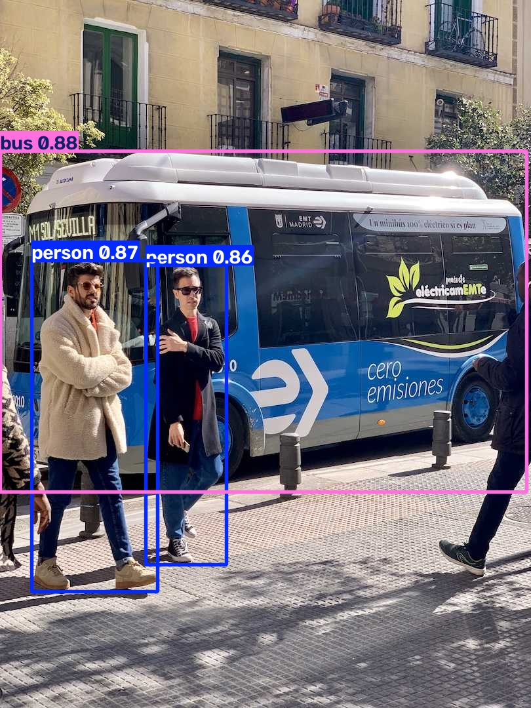

# T02：指定圖片、輸出目錄，並比較信心門檻

**兩組案例及新程序重跑全部通過。** 同一張圖片，`conf=0.25` 得到 5 個框；改為 `conf=0.85` 後剩 3 個框。沒有執行錯誤或 WARNING。

回到 [結果總覽](../README.md)。本次使用官方 CLI 的參數語法設計比較案例，未逐字執行整頁所有教學。

## 輸入與整體流程

輸入是 T01 已下載的 `bus.jpg` 和 `yolo26n.pt`。沿用 uv CPU 環境，沒有重新安裝或下載。


流程：讀取本機模型與圖片 → 預測物件 → 依信心門檻篩選 → 存入指定目錄 → 比較圖片與文字結果。`conf` 是保留偵測結果的門檻；提高它不會重新訓練模型，也不代表準確率必然提高。

## 可重跑的指令

在 PowerShell 先恢復 T01 環境。每次重跑使用新的 project 目錄，避免讀到舊輸出：

```powershell
$runRoot = 'C:\Users\edisonhsieh\AppData\Local\Temp\ultralytics-tutorial-0d928fdb911d405f850a79ca00613d55'
$env:YOLO_CONFIG_DIR = Join-Path $runRoot 'config'
$env:UV_CACHE_DIR = Join-Path $env:TEMP 'ultralytics-validation-uv-cache'
$yolo = Join-Path $runRoot '.venv\Scripts\yolo.exe'
$model = Join-Path $runRoot 'yolo26n.pt'
$source = Join-Path $runRoot 'bus.jpg'
$project = Join-Path $runRoot ('t02-' + [guid]::NewGuid().ToString('N'))
Set-Location $runRoot

& $yolo detect predict "model=$model" "source=$source" "project=$project" name=baseline conf=0.25 save_txt=True save_conf=True
# 檢查 $LASTEXITCODE，成功後再執行下一組。
& $yolo detect predict "model=$model" "source=$source" "project=$project" name=high-conf conf=0.85 save_txt=True save_conf=True
```

`project` 指定輸出根目錄，`name` 指定案例子目錄。`save_txt=True` 保存框座標；`save_conf=True` 在文字結果加上分數。兩組只有 `conf` 影響預測的參數不同，`name` 則用來分開存檔。

實測以 [執行腳本](T02-assets/logs/run.py) 呼叫真正的 `yolo.exe`，擷取退出碼與完整日誌，並非改走 Python 預測 API。實際參數陣列在 [首次執行紀錄](T02-assets/logs/summary.json)。以上 PowerShell 是等價的人工重跑方式。

保存的 `run.py` 是當次執行原稿，固定讀取 `t02/baseline` 和 `t02/high-conf`。不要在已有輸出的目錄直接重跑它：CLI 可能自動另建目錄，但原稿仍會讀取舊結果。日後重跑請使用上方每次產生新 project 目錄的 PowerShell 指令，並查看該次輸出的圖片與文字檔。

<a id="t02-a"></a>

## T02-A：基準門檻 conf=0.25

| 項目 | 實際結果 |
| --- | --- |
| 輸入 | 本機 bus.jpg、yolo26n.pt，門檻 0.25 |
| 預期 | 預測並儲存圖片和帶分數的文字結果；框數以實測為準 |
| 輸出 | 4 個行人、1 輛公車，共 5 個框 |
| 位置 | `$runRoot/t02/baseline/bus.jpg` 及 `labels/bus.txt` |
| 退出碼／程序耗時 | 0／7.144 秒 |
| 錯誤／警告 | 無；指定 source 後，沒有 T01 的缺少來源警告 |
| 證據 | [日誌](T02-assets/logs/baseline.log)、[框與分數](T02-assets/output/baseline.txt) |

<a id="t02-b"></a>

## T02-B：提高門檻至 conf=0.85

| 項目 | 實際結果 |
| --- | --- |
| 輸入 | 相同圖片與模型，門檻提高至 0.85 |
| 預期 | 排除低於門檻的偵測；不預設剩餘框數 |
| 輸出 | 2 個行人、1 輛公車，共 3 個框 |
| 位置 | `$runRoot/t02/high-conf/bus.jpg` 及 `labels/bus.txt` |
| 退出碼／程序耗時 | 0／6.646 秒 |
| 錯誤／警告 | 無；沒有需要修復才能執行的問題 |
| 證據 | [日誌](T02-assets/logs/high-conf.log)、[框與分數](T02-assets/output/high-conf.txt) |

## 輸出並排比較

| conf=0.25：5 個框 | conf=0.85：3 個框 |
| --- | --- |
|  |  |

圖片只是原始結果的副本，沒有編修。已目視確認高門檻輸出少了左右邊緣的行人框，並以文字結果核對數量和分數。

| 物件 | 文字結果中的信心分數 | 圖上顯示 | 0.25 組 | 0.85 組 |
| --- | --- | --- | --- | --- |
| 公車 | 0.880600 | 0.88 | 保留 | 保留 |
| 左側主要行人 | 0.872011 | 0.87 | 保留 | 保留 |
| 中間行人 | 0.860808 | 0.86 | 保留 | 保留 |
| 右側邊緣行人 | 0.846248 | 0.85 | 保留 | 排除 |
| 最左側部分入鏡行人 | 0.656220 | 0.66 | 保留 | 排除 |

**圖上看起來是 0.85，不代表原始分數達到 0.85。** 標籤只顯示兩位小數；0.846248 四捨五入後顯示 0.85，但仍低於篩選門檻。這是正常顯示行為，不是此次發現的篩選 bug。文字檔本身也經格式化，並非完整浮點精度，但足以判讀這次差異。

文字檔每列為 `類別編號 中心x 中心y 寬 高 信心分數`。座標以圖片寬高正規化；本模型的 0 是 person、5 是 bus。不要把文字檔的六欄，誤當成 T01 記憶體中 `boxes.data` 的六欄：兩者座標格式與類別欄位位置不同。

提高門檻後少了兩個肉眼可見的行人框，說明門檻有取捨。這次沒有標註資料集，因此不評估整體精確率、召回率或 mAP。

## 重跑確認

同一環境、模型與輸入，在新 CLI 程序重新執行兩組，輸出至 `$runRoot/t02-repeat/`。

| 案例 | 退出碼 | 程序耗時 | 比較結果 |
| --- | --- | --- | --- |
| 基準組 | 0 | 8.187 秒 | 5 個框，文字結果逐行與首次相同 |
| 高門檻組 | 0 | 6.761 秒 | 3 個框，文字結果逐行與首次相同 |

證據：[重跑紀錄](T02-assets/logs/repeat-summary.json)、[基準日誌](T02-assets/logs/baseline-repeat.log)、[高門檻日誌](T02-assets/logs/high-conf-repeat.log)。首次推論日誌中的模型推論時間約 52.0／51.3 ms；表格中的秒數是整個程序耗時，不能當成效能比較。

## 教學卡點、其他障礙與貢獻判斷

| 發生處 | 觀察 | 判斷與處置 |
| --- | --- | --- |
| 查參數 | CLI 頁提供 arg=value 語法，完整參數需沿連結查 Configuration／Predict 說明 | 有明確入口，這次未形成阻塞 |
| 解讀門檻 | 圖上 0.85 的框被 0.85 門檻排除 | 兩位小數顯示造成的理解落差；以文字分數釐清，先作個人教學註記 |
| 解讀日誌 | `1 label saved`，但文字檔有 5 或 3 列 | 此處指保存一個標籤檔，不是只偵測一個物件；未判定需要上游修改 |
| 讀取 Git 狀態 | 全域 ignore 檔權限警告 | 本機沙箱現象，不影響預測 |

四次 CLI 執行均無 ERROR、WARNING 或 traceback，未做失敗後修復。沒有出現新的環境安裝問題；資產已在本機，不能據此推論首次下載必定順利。

已查本機 `docs/en/usage/cli.md`、`docs/macros/predict-args.md`、`ultralytics/cfg/default.yaml` 與 `ultralytics/engine/results.py`。結果程式碼使用兩位小數顯示分數，與觀察一致。尚未搜尋相關 issue／PR，也未驗證最新 upstream main；目前沒有確認的產品缺陷，不開 PR、不新增測試。T01 的 weights_dir 疑問仍留待 T05。

## 版本、來源與範圍

- 日期：2026-10-28。文件來源：[官方 CLI](https://docs.ultralytics.com/usage/cli/)，本次閱讀本機文件快照。
- 本機文件 HEAD：`9662a727384611b7c28c2428ac252b7d57329b47`；研究目錄有未提交文件，執行使用 PyPI 套件，非 editable 原始碼。
- Windows 11、PowerShell、Intel Core Ultra 7 265H；uv 0.11.23、Python 3.13.14、torch 2.14.1+cpu、Ultralytics 8.4.191。
- [環境資訊](T02-assets/logs/environment.json)、[套件版本清單](T02-assets/logs/requirements-resolved.txt)。
- 與原例差異：CLI 頁 Predict/Official 範例使用圖片網址；本次改用同圖的本機副本，加入 project、name、conf、save_txt、save_conf 做受控比較。
- 未驗證：整頁其他命令、YouTube 分割範例、訓練、驗證、匯出、GPU、其他圖片及門檻邊界的所有情境。
- 展示資產已保存在 `T02-assets/`；日誌移除終端機控制碼並將本機根目錄替換成 `<RUN_ROOT>`，其他內容保留。原始檔與模型仍在 T01 的 Temp 執行根目錄。

## 下一步

T03：使用 Python 讀取同圖的框座標、類別與信心分數，說明如何從 `Results` 取得資料，並將欄位對照到圖片上的物件。沿用目前環境，執行前先確認 Temp 資產仍存在。
