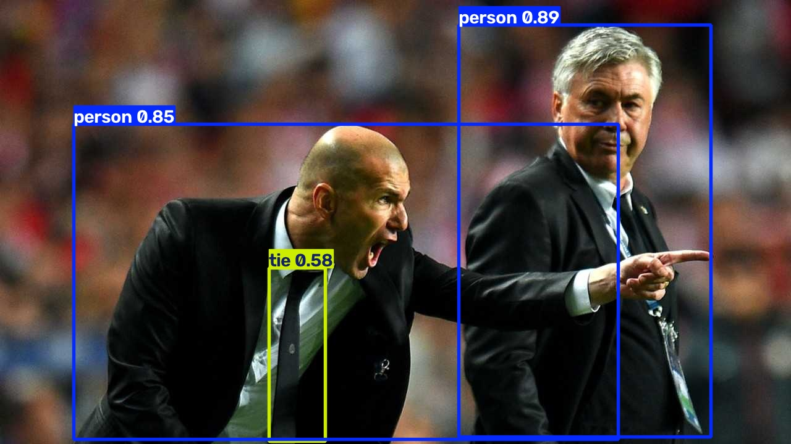

# T04：從單圖、資料夾到影片，讀取 stream=True 結果

**四個案例與新程序重跑都通過。** 單圖取得 1 個結果，資料夾取得 2 個結果，影片的兩種模式各取得 10 個結果。影片 list 模式有記憶體警告，沒有執行錯誤。

回到 [結果總覽](../README.md)。本次只驗證本機來源；`stream=True` 是逐個取得結果的方式，不表示輸入一定來自網路串流。

## 先看輸入與輸出

| 輸入 | 實際輸出 |
| --- | --- |
|  |  |
|  |  |

影片使用公車圖縮放至 **406 × 540**，以 MJPG 編碼存成 AVI：每秒 5 影格、共 10 影格、長 2 秒。十張影格內容相同，這是驗證影片讀寫的合成素材，不能拿來評估追蹤或移動物件辨識。


上圖是影片第一個 Results 用 `save()` 保存的圖片，並非從輸出 AVI 解碼後擷取。另已實際重新開啟兩個輸出 AVI，逐張解碼，確認各有 10 影格、5 FPS。圖片已目視檢查。影片縮放及壓縮後分數與原圖不同，不能要求它等於 T03 的分數。

## 四個案例怎麼跑、得到什麼

共用模型 `yolo26n.pt`，設定 `device="cpu"`、`conf=0.25`、`save=True`，各用不同輸出目錄。完整準備、預測與驗證流程見 [t04.py](T04-assets/logs/t04.py)。

<a id="t04-a"></a>

### T04-A：單張圖片

輸入 `input/bus.jpg` → `model(source, stream=False, ...)` → 得到 list → 讀取並保存結果。預期 1 個 Results，實際為 1 個，內有 4 個 person 與 1 個 bus。輸出位置是 `single/bus.jpg`。

Error：無。Warning：無。結果清單的長度是圖片數，不是框數；框數要看 `len(result.boxes)`。

<a id="t04-b"></a>

### T04-B：兩張圖片的資料夾

把公車圖與套件內建 `zidane.jpg` 放進 `input/` → 用資料夾路徑預測 → 逐張讀取 list。預期 2 個 Results，實際為 2 個：bus 有 5 框，zidane 有 3 框（2 人、1 領帶）。輸出分別是 `folder/bus.jpg`、`folder/zidane.jpg`。

Error：無。Warning：無。這次資料夾沒有子目錄或影片，也未測試遞迴搜尋。官方 directory 分頁用 `stream=True`；本案例刻意改成 False，先讓讀者對照多圖 list，串流方式在 T04-D 驗證。

<a id="t04-c"></a>

### T04-C：影片一次取得全部結果

準備 `short.avi` → `model(video, stream=False, ...)` → 取得完整 list → 檢查 10 個 Results → 重新開啟 `video_list/short.avi` 解碼驗證。

實際 10 個結果，每個 5 框；輸出影片也有 10 影格。Error：無。Warning：有，提醒結果會累積於記憶體，長影片應使用 `stream=True`。警告完整內容保存在 [首次日誌](T04-assets/logs/first.log)，開頭如下：

```text
WARNING
Inference results will accumulate in RAM unless `stream=True` is passed, which can cause out-of-memory errors for large
sources or long-running streams and videos.
```

這段短影片沒有記憶體不足，退出碼為 0。警告並不表示推論失敗；也不能因短片成功，就推論長影片能安全使用 list。

<a id="t04-d"></a>

### T04-D：逐個消費 stream=True 的結果

同一影片 → `model(video, stream=True, ...)` → 得到 generator（需要迭代才逐個交出結果的物件）→ 用 `for` 消費全部結果 → 檢查及存檔 → 解碼輸出 AVI。

```python
results = model("short.avi", stream=True, device="cpu", save=True)
for result in results:
    print(result.path, len(result.boxes))
```

實測取得 generator 後、尚未迭代時，該案例輸出目錄不存在；完成迭代後才有影片。最後取得 10 個結果，每個 5 框，框座標、分數及類別逐項等於 T04-C。輸出 `video_stream/short.avi` 可解碼，10 影格、5 FPS。

Error：無。Warning：無。只寫 `results = model(..., stream=True)` 不足以完成此預測流程。別為了方便又寫 `list(results)` 收集長影片的全部 Results，那會失去逐個處理的記憶體好處。本驗證腳本只把十個結果的數值存成紀錄，沒有量測記憶體峰值。

## 首次與重跑的證據

| 案例 | Results 數／每個框數 | 首次秒數 | 重跑秒數 |
| --- | --- | --- | --- |
| 單圖 | 1／5 | 2.704 | 2.881 |
| 資料夾 | 2／5、3 | 0.113 | 0.095 |
| 影片 list | 10／各 5 | 0.427 | 0.404 |
| 影片 generator | 10／各 5 | 0.369 | 0.399 |

時間從各案例呼叫開始，到結果迭代及代表圖片存檔結束；不含模型建構、素材準備或隨後解碼影片的檢查。四案依序共用模型，單圖包含第一次推論準備，所以這張表不能用來比較來源效能。

兩個新 Python 程序退出碼均為 0，各用新的輸出目錄。各案例的結果數值在重跑後完全相同。程式內 assertions 已檢查回傳型別、結果數、迭代前輸出目錄、影片模式結果相等，以及輸出影片實際解碼數。

- [首次日誌](T04-assets/logs/first.log)、[重跑日誌](T04-assets/logs/repeat.log)
- [首次完整框資料與耗時](T04-assets/logs/results.json)、[重跑資料](T04-assets/logs/repeat-results.json)
- [退出碼及跨程序比較](T04-assets/logs/execution.json)、[套件版本清單](T04-assets/logs/requirements-resolved.txt)

## 在你的電腦重跑

沿用 T01 的 uv 環境，沒有新增依賴或下載。腳本從工作目錄讀取模型與公車圖，再從安裝套件取得球員圖；影片會自行產生。每次指定新輸出目錄，腳本會拒絕覆寫既有目錄。

```powershell
$repo = 'D:\tools\ultralytics\.worktrees\contribution-research'
$runRoot = 'C:\Users\edisonhsieh\AppData\Local\Temp\ultralytics-tutorial-0d928fdb911d405f850a79ca00613d55'
$env:YOLO_CONFIG_DIR = Join-Path $runRoot 'config'
$env:UV_CACHE_DIR = Join-Path $env:TEMP 'ultralytics-validation-uv-cache'
$python = Join-Path $runRoot '.venv\Scripts\python.exe'
$script = Join-Path $repo 'research\tutorial-audit\records\T04-assets\logs\t04.py'
$output = Join-Path $runRoot ('t04-' + [guid]::NewGuid().ToString('N'))
Set-Location $runRoot
& $python $script $output
$LASTEXITCODE
Get-ChildItem $output -Recurse
```

預期退出碼為 0，最後印出 `PASS`。影片 list 案例出現上述警告屬本次預期行為。若 Temp 已清除，先依 [T01](T01.md) 重建環境與資產。

本次原始影片位於 `$runRoot/t04/short.avi`，輸出位於 `$runRoot/t04/video_list/short.avi` 和 `$runRoot/t04/video_stream/short.avi`；重跑在 `$runRoot/t04-repeat/`。影片留在執行目錄，研究目錄保留圖片、腳本和數值證據。Temp 可能清除，屆時需重跑產生影片。

## 教學卡點、調整與貢獻判斷

| 步驟 | 觀察到的問題或提醒 | 分類與處置 |
| --- | --- | --- |
| 準備資料 | 官方路徑是占位文字，沒有附上本次需要的影片 | 自行準備最小合成影片，明記限制；不是產品 bug |
| 影片 list | 出現記憶體累積警告 | 正常產品提醒；同片改 stream=True 並迭代後沒有此警告 |
| 影片分頁 | 本機分頁停在建立 generator，單獨複製不會跑完推論 | 頁首已有迭代示例；可考慮在分頁連回該示例，但不足以認定文件缺陷 |
| 保存影片 | Windows 輸出為 AVI，這次可正常解碼 | 未遇編碼器錯誤；不能保證所有播放軟體都支援 |
| Git 查狀態 | 全域 ignore 檔權限警告 | 本機環境問題，不影響本次推論 |
| 整理文件 | PowerShell 管線傳遞中文，導致索引文字替換未生效 | 文件編輯工具問題；改用直接補丁修正，並重新檢查連結 |

相對原文：代入本機資料與模型、明確指定 CPU、增加保存與 assertions；資料夾使用 list，影片額外比較 list 與 generator；省略 GUI `show()`。這是按官方用法組成的驗證流程，沒有逐字執行整頁所有分頁。首次主流程沒有失敗，因此沒有隱藏的失敗後修正。

本次沒有確認產品缺陷，也不新增上游測試。迭代提示僅留作文件候選；尚未搜尋 issue／PR 或驗證最新 upstream main，提出貢獻前仍須查重。

## 來源與適用範圍

- 日期：2026-10-28；Windows 11／PowerShell，Intel Core Ultra 7 265H、CPU 路徑。
- uv 0.11.23、Python 3.13.14、torch 2.14.1+cpu、PyPI Ultralytics 8.4.191，非 editable。
- 閱讀 [官方 Predict 頁](https://docs.ultralytics.com/modes/predict/) 及本機 `docs/en/modes/predict.md` 的 Predict、Inference Sources 中 image／video／directory 範例。網頁工具未展開所有分頁，逐行分頁依據採本機文件 HEAD `9662a727384611b7c28c2428ac252b7d57329b47`。
- 展示日誌轉為 UTF-8、移除終端色碼，執行根目錄替換為 `<RUN_ROOT>`；原始日誌仍在 Temp。套件清單沿用同一未變動環境。
- 未測 GPU、攝影機、RTSP、YouTube、長影片、真實移動、提早中止 generator、遞迴目錄、混合來源或其他編碼。沒有宣稱整篇 Predict 教程完成。

## 下一步

T05：驗證 Settings 的資料、權重及輸出路徑，重開程序確認是否持續有效，並釐清 T01 的模型下載位置疑問。
