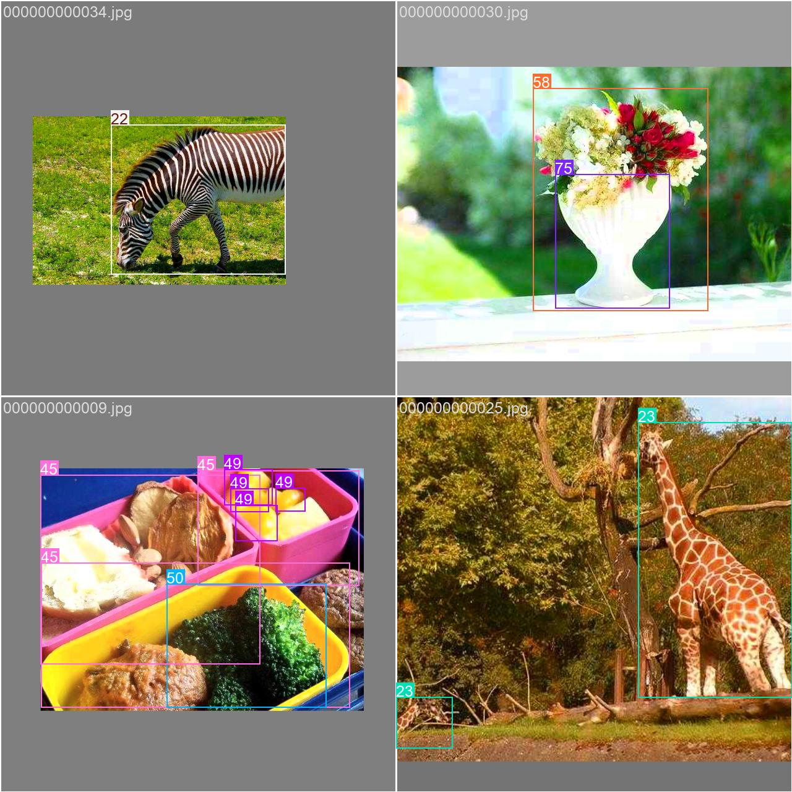
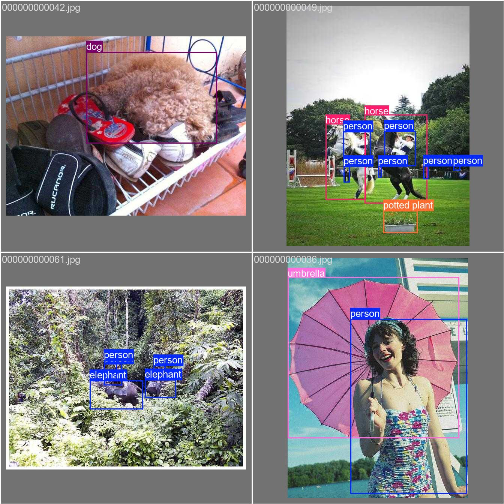
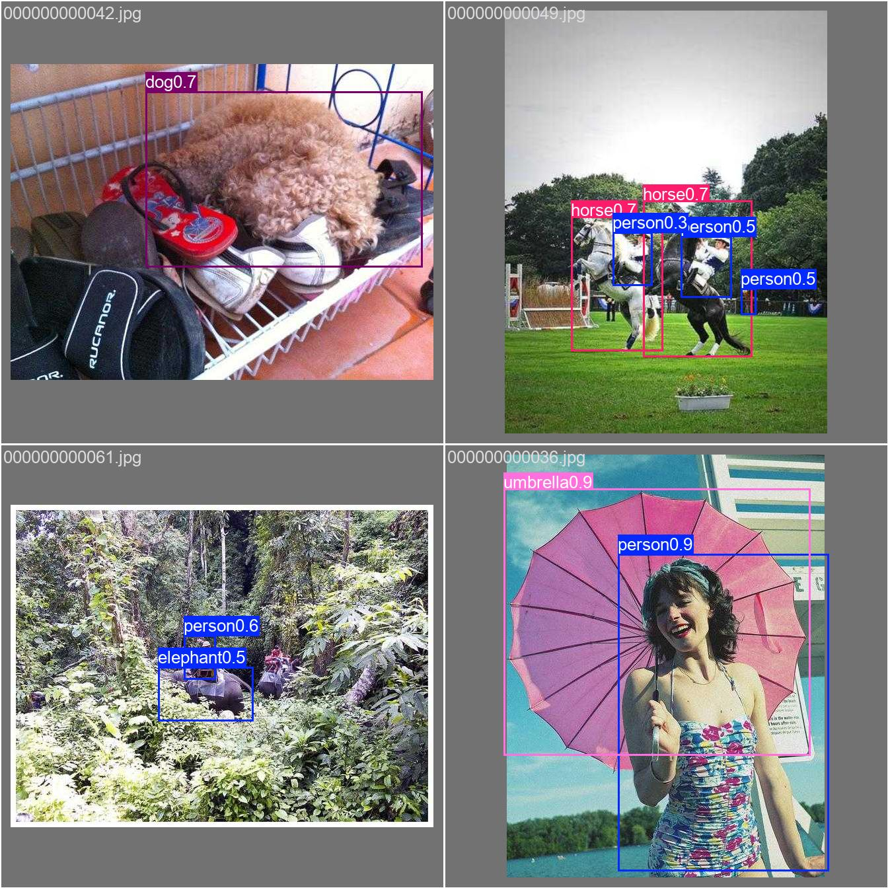
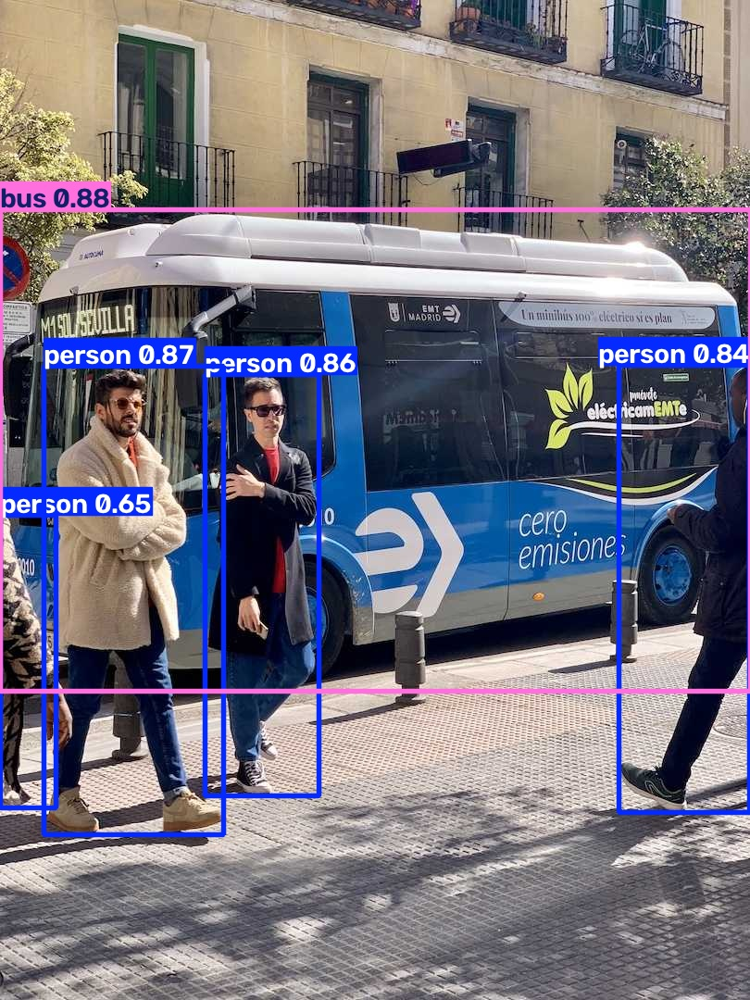

# T06：用 COCO8 完成 CPU 短訓練，再載入模型

**訓練與模型重載均通過，獨立程序重跑也通過。** 首次下載因沙箱網路權限失敗；允許網路後，相同訓練參數成功。這次只驗證流程，不能據此判斷模型品質。

回到 [結果總覽](../README.md)。下一步是 T07：獨立驗證本次保存的模型。

## 本次跑了什麼

- 來源：[官方 Train](https://docs.ultralytics.com/modes/train/) 的 Usage Examples／預訓練 Python 路徑；本機 `docs/en/modes/train.md`。資料來源為 [COCO8](https://docs.ultralytics.com/datasets/detect/coco8/)，4 張訓練圖、4 張驗證圖。
- 查閱與執行：2026-10-28；文件快照 HEAD `9662a727384611b7c28c2428ac252b7d57329b47`，另查閱當日官網。
- Windows 11、PowerShell、Intel Core Ultra 7 265H、CPU；沿用 uv 0.11.23 建立的環境，Python 3.13.14、torch 2.14.1+cpu、PyPI ultralytics 8.4.191，非 editable。見 [版本與模型雜湊](T06-assets/logs/verification.json)。
- 官方原例為 100 epochs、imgsz=640。本次依 PLAN 縮為 1 epoch，保留 640，明確指定 CPU、模型絕對路徑、獨立 project/name，加入文件提醒的 `__main__` 保護。沒有執行原版 100 epochs，也未跑 YAML 建模及 CLI 分頁。
- 使用真正 COCO8 標註；沒有使用 T05 的合成路徑探測資料。

<a id="t06-a"></a>

## T06-A：訓練一輪，產生 checkpoint

流程：載入 `yolo26n.pt` → 自動下載 COCO8 與繪圖字型 → 檢查影像和標註 → 訓練一輪 → 驗證 → 保存模型及圖表。完整 [腳本](T06-assets/logs/t06.py) 會檢查兩個模型檔存在且非空。

| 輸入／設定 | 實際內容 |
| --- | --- |
| 預訓練模型 | yolo26n.pt，5,544,453 bytes；載入 708/708 項權重 |
| 資料設定 | [安裝套件的 coco8.yaml](T06-assets/input/coco8.yaml)；資料下載到專用 datasets/coco8 |
| 訓練 | epochs=1、imgsz=640、device=cpu；其他參數見 [args.yaml](T06-assets/logs/args.yaml) |
| 資料檢查 | train 4 張、val 4 張；兩邊均 0 corrupt、0 backgrounds；驗證有 17 個標註物件 |
| 預期產物 | best.pt、last.pt、數值與預覽圖 |
| 實際產物 | 全數產生；兩個模型各 5,523,141 bytes |

這是實際送入訓練的批次預覽，含資料增強後的影像與標註框：



| 驗證資料的標註 | 模型預測 |
| --- | --- |
|  |  |

標註圖代表資料提供的答案；預測圖是模型輸出，數字是信心分數。圖上沒有框不代表物件不存在，不能把預測當作正確答案。

### 數值怎麼讀

以下來自訓練結束後對 best.pt 的自動驗證，[完整 JSON](T06-assets/logs/metrics.json)。

| 指標 | 實測 | 意義 |
| --- | --- | --- |
| Precision | 0.537554 | 評估所用操作點下，預測的準確程度 |
| Recall | 0.966667 | 評估所用操作點下，找回標註物件的程度 |
| mAP50 | 0.942222 | 框重疊門檻 0.50 下，跨類別的平均精度 |
| mAP50–95 | 0.695148 | 跨多個框重疊門檻的平均精度，要求較嚴格 |

這些是套件彙總指標，不可直接把數值乘上 17 當成整數命中數。只有 4 張驗證圖，且模型已預訓練，不能解讀為一輪就學會辨識，也未驗證與預訓練資料是否重疊。

[results.csv](T06-assets/logs/results.csv) 只有 epoch=1 一列；訓練損失 box=0.84472、cls=1.8214、l1=0.0126。損失是優化目標，不是準確率。CSV 的 epoch 驗證數字與結尾 best.pt 驗證略有差異（例如 precision 0.5383 對 0.537554）；這次保留兩份原值，尚未定位差異來源。

[results.png](T06-assets/output/results.png) 只有單點，不能判斷收斂趨勢。

<a id="t06-b"></a>

## T06-B：新程序載入 best.pt 與 last.pt

訓練程序結束後，另開 Python 程序，分別用 `YOLO(checkpoint)` 載入兩個檔案，再預測公車圖。兩者都得到 **4 個 person、1 個 bus**，保存圖片且影像尺寸檢查通過。這驗證可供推論使用，沒有測試 `resume=True` 續訓。

| 輸入公車圖 | best.pt 載入後的輸出 |
| --- | --- |
|  |  |

見 [重載日誌](T06-assets/logs/reload.log) 與 [完整框資料](T06-assets/logs/reload.json)。兩個 checkpoint 名稱不同，單輪結果也不能用來比較最佳 epoch。

## 錯誤、警告與教學卡點

| 發生處 | 實際情況 | 判斷與處理 |
| --- | --- | --- |
| 首次下載 | WinError 10013，重試後 RuntimeError，退出碼 1；尚未訓練 | 沙箱網路限制。保留 [完整失敗日誌](T06-assets/logs/failed-train.log)，允許網路後原參數成功 |
| 首次可連網執行 | WARNING Dataset images not found，接著自動下載成功 | 正常首次準備提示，並非資料損毀；壓縮檔進度顯示 432.8 KB |
| 首次繪圖 | 額外下載 Arial.ttf，進度顯示 755.1 KB | 權重已存在仍需要網路。字型存於專用 config/Ultralytics；沒有下載失敗 |
| 訓練參數 | optimizer=auto 提示忽略 lr0，自選 AdamW | 資訊提示，非錯誤；本次未手動指定 lr0 |
| Windows workers | 參數列 workers=8，但實際 Using 0 dataloader workers | CPU 實測走單程序資料載入；不能據此宣稱 Windows 多程序也通過 |
| 重跑資料掃描 | WARNING train: Slow image access detected，讀取 23.5±18.7 MB/s | 本機 Temp 仍觸發效能提示，未阻止訓練；不能由這則提示推論資料放在遠端。未做磁碟效能診斷 |
| 證據整理工具 | 整理完成後額外 import 忘設 YOLO_CONFIG_DIR，觸發全域設定 schema 警告及兩次 Permission denied 寫入錯誤，命令仍退出 0 | 我的操作疏漏，非訓練錯誤。工具輸出有紀錄，未存原始檔；寫入被拒。補設專用目錄後 import 無警告，回報專用 settings 路徑 |
| 文件連結檢查 | 首次誤用全域 python，Windows 回報無法存取 python.exe | 我的工具操作疏漏；改用 uv 環境內的完整 python.exe 路徑後檢查通過。重跑指令已使用完整路徑 |

教學主流程可完成，Windows 保護與自動下載已有說明。第一次使用者仍需知道：下載、字型、訓練、驗證各是不同階段；訓練正常完成後，結果目錄才是檢查產物的入口。本次沒有發現已確認產品缺陷。

## 調整與重跑證據

| 執行 | 訓練程序耗時／退出碼 | 重載程序耗時／退出碼 |
| --- | --- | --- |
| 沙箱首次 t06 | 42.60 秒／1 | 未執行 |
| 可連網 t06-online | 31.97 秒／0 | 7.62 秒／0 |
| 獨立目錄 t06-repeat | 21.20 秒／0 | 8.02 秒／0 |

耗時包含程序啟動與初始化；第一個成功訓練另含下載。重跑沿用同環境、已下載資料、字型與標註快取；重新載入原始預訓練權重，未接續上一輪 checkpoint。因此它驗證重新執行，不是第二次乾淨安裝或下載測試。

重跑的最終 metrics JSON、兩個 checkpoint 的預測摘要均與首輪完全相同，assert 比較通過。見 [檢查結果](T06-assets/logs/verification.json)、[首輪耗時](T06-assets/logs/execution.json)、[重跑耗時](T06-assets/logs/repeat-execution.json)、[重跑訓練日誌](T06-assets/logs/repeat-train.log)、[重跑預測日誌](T06-assets/logs/repeat-reload.log)。重跑無例外，但有上述慢速讀取警告；收尾時「無警告」檢查未通過，逐項查閱後已修正文稿。

## 在本機重跑

沿用 T01 的 uv 環境，不需另裝套件。若 Temp 已清除，先依 [T01](T01.md) 重建環境、模型、圖片與專用設定。

```powershell
$repo = 'D:\tools\ultralytics\.worktrees\contribution-research'
$runRoot = Join-Path $env:TEMP 'ultralytics-tutorial-0d928fdb911d405f850a79ca00613d55'
Set-Location $runRoot
$env:UV_CACHE_DIR = Join-Path $env:TEMP 'ultralytics-validation-uv-cache'
$env:YOLO_CONFIG_DIR = Join-Path $runRoot 'config'
$env:PYTHONIOENCODING = 'utf-8'
$python = Join-Path $runRoot '.venv\Scripts\python.exe'
$out = Join-Path $runRoot ('t06-' + [guid]::NewGuid().ToString('N'))
& $python "$repo\research\tutorial-audit\records\T06-assets\logs\t06.py" $out
if ($LASTEXITCODE -ne 0) { throw "T06 failed: inspect $out\train.log and reload.log" }
Get-Content "$out\execution.json"
```

腳本拒絕已存在的輸出目錄，避免覆蓋；子程序完整輸出寫入日誌，所以執行中終端可能暫無文字。首次需要連網。主要產物如下：

- `$out/train/weights/best.pt`、`last.pt`：模型。
- `$out/train/args.yaml`、`results.csv`：實際參數與逐輪指標。
- `$out/train/train_batch0.jpg`、`val_batch0_labels.jpg`、`val_batch0_pred.jpg`：訓練與驗證圖。
- `$out/reload-best/bus.jpg`、`reload-last/bus.jpg`：重新載入後的預測。
- `$out/train.log`、`reload.log`、`execution.json`、`metrics.json`、`reload.json`：完整執行證據。

本次實際成功目錄為上述 runRoot 下的 `t06-online`，重跑為 `t06-repeat`。模型與原始資料保留在 Temp，沒有提交 Git；Temp 清除會遺失模型。展示副本已保存於本紀錄旁，日誌移除 ANSI 控制碼、以 `<RUN_ROOT>` 取代個人執行路徑；沒有省略失敗 traceback。COCO8 圖片來源及授權資訊見官方資料頁。

## 貢獻候選與下一步

目前不開 PR。網路權限及整理工具的環境變數疏漏屬本機問題；Windows 保護、optimizer=auto 在官方已有說明。可再研究「首次訓練所需下載與產物位置」是否值得補入現有文件，但尚未搜尋 issue／PR、未核對最新 upstream main，不能視為已成立的缺漏。CSV 與結尾指標的小差異交給 T07 核對。

**T07 第一個動作：** 確認 `$runRoot/t06-online/train/weights/best.pt` 存在，再依官方 Val 範例，以 COCO8 的 val 切分獨立驗證；對照本次 metrics JSON 與 CSV，解釋指標和輸出圖。

未驗證：100 epochs、CUDA、多 GPU、Windows 多程序、自訂資料、從零訓練、續訓、泛化品質。未修改上游程式或新增 pytest。
