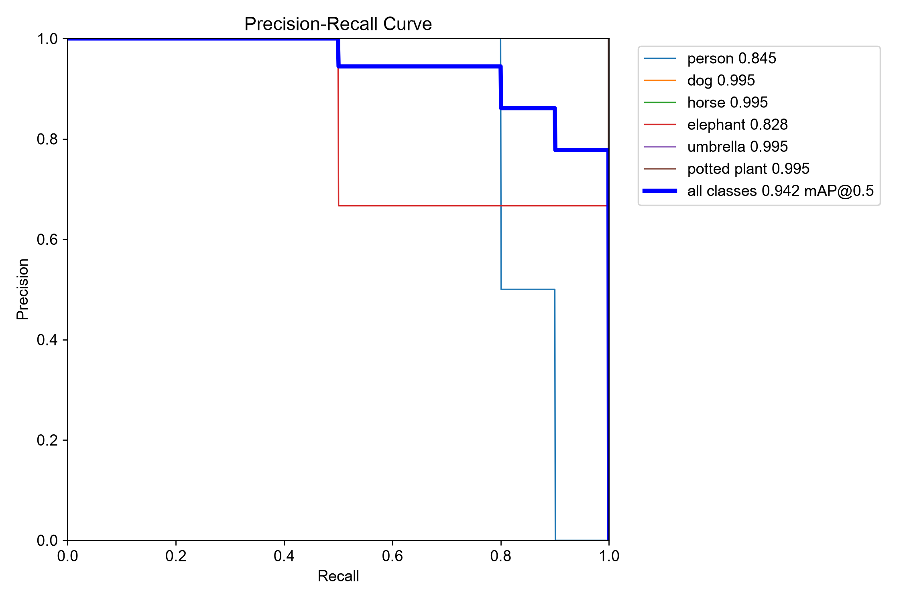

# T07：獨立驗證 T06 模型，讀懂指標與輸出

**兩次獨立驗證均成功，沒有錯誤或警告。** 最終指標與 T06 訓練結尾驗證完全一致；逐圖指標及類別陣列也在新程序重跑得到相同結果。

回到 [結果總覽](../README.md)。下一項為 T08 物件追蹤。

## 範圍與環境

- 來源：[官方 Val](https://docs.ultralytics.com/modes/val/) Usage Examples 的自訂模型 Python 分頁；本機 `docs/en/modes/val.md`，快照 `9662a727384611b7c28c2428ac252b7d57329b47`。查閱、執行日期：2026-10-28。
- 沿用 uv 0.11.23 的環境：Windows 11／PowerShell、Intel Core Ultra 7 265H、Python 3.13.14、torch 2.14.1+cpu、PyPI ultralytics 8.4.191，非 editable。
- 模型是 T06 的 `t06-online/train/weights/best.pt`，不是原始官方權重。模型大小與雜湊見 [T06 證據](T06-assets/logs/verification.json)。資料與字型已在 T06 下載，不需新依賴。
- 原例的 `path/to/best.pt` 換成實際路徑，加入 Windows `__main__` 保護及明確 CPU／輸出目錄。未傳 `data`、`imgsz`，用來驗證模型記住的設定。不是逐字、零參數原例。

<a id="t07-a"></a>

## T07-A：載入模型，使用記住的資料設定驗證

流程：載入 best.pt → 讀取模型設定 → 掃描 COCO8 val → 預測 4 張圖 → 對照 17 個標註物件 → 保存指標與圖片。沒有再訓練，也沒有把 train 切分當成 val。

[執行腳本](T07-assets/logs/t07.py) 的核心為：

```python
model = YOLO(checkpoint)
metrics = model.val(device="cpu", project=str(out), name="val")
```

預期：能找到訓練資料設定、完成驗證並產生圖表。實際：模型記住安裝套件內的 `coco8.yaml` 與 `imgsz=640`；日誌確認讀取 `datasets/coco8/labels/val.cache`，4 張圖、0 backgrounds、0 corrupt。完整設定路徑與數值見 [results.json](T07-assets/logs/results.json)。

| 指標 | T07 實測 | 與 T06 結尾驗證比較 |
| --- | --- | --- |
| Precision | 0.537554 | 完全相同 |
| Recall | 0.966667 | 完全相同 |
| mAP50 | 0.942222 | 完全相同 |
| mAP75 | 0.813025 | T06 未另外保存此欄 |
| mAP50–95 | 0.695148 | 完全相同 |

Precision 描述預測的準確程度，Recall 描述找回標註物件的程度。mAP 是跨類別平均精度；50、75 是框重疊比例門檻，50–95 則涵蓋多個門檻。總表的 precision／recall 使用最大平均 F1 對應的信心門檻，不等於下方逐圖計數的簡單平均。

| 資料提供的標註 | 模型輸出 |
| --- | --- |
|  |  |

預測圖是預覽，不能靠目視框數重建完整評分。還有 [混淆矩陣](T07-assets/output/confusion_matrix.png)，用來看類別混淆、漏檢與誤報；它的計數門檻也不能直接視為總表的最佳 F1 門檻。



橫軸是 Recall、縱軸是 Precision。曲線描述改變信心門檻時的取捨；圖例的 0.942 對應 mAP50，並非 mAP50–95。只有 4 張驗證圖，這些數字不能證明實際部署品質。

<a id="t07-b"></a>

## T07-B：讀取逐圖與逐類別結果

同一次驗證後，腳本讀取官方列出的 `map`、`map50`、`map75`、`maps` 與 `image_metrics`，不需再次推論。

| 圖片 | TP 正確匹配 | FP 誤報 | FN 漏檢 | 逐圖 precision |
| --- | --- | --- | --- | --- |
| 000000000042.jpg | 1 | 214 | 0 | 0.004651 |
| 000000000061.jpg | 5 | 138 | 0 | 0.034965 |
| 000000000049.jpg | 8 | 150 | 1 | 0.050633 |
| 000000000036.jpg | 2 | 22 | 0 | 0.083333 |

例如第一張是 `1 / (1 + 214)`。逐圖統計在 IoU=0.5 下計算，包含驗證預設低信心門檻 0.001 保留的候選框，因此誤報很多。它與總表選用的門檻不同，不能直接比較後判定矛盾；本次沒有把 conf 提高到 0.25 重跑。

`maps` 有 80 個位置，但 `ap_class_index` 只有 **0、16、17、20、25、58**，即 person、dog、horse、elephant、umbrella、potted plant。其餘類別沒有這次的獨立評估證據。安裝版 `Metric.maps` 先用整體 mAP 填滿陣列，再覆寫有評估的類別；因此未出現的類別也顯示 0.695148，不能當成它們各自的成績。見 [安裝版原始碼摘錄](T07-assets/logs/installed-source.txt)。

## T06 的 CSV 為何略有不同

T06 CSV 的 epoch precision 是 0.5383，結尾保存模型驗證是 0.537554。本次重新載入同一 best.pt 得到後者，證明保存模型的結果可重現。

安裝版 `save_model` 會把模型副本轉為 FP16 保存，`final_eval` 再載入 best.pt；這提供「記憶體中的 epoch 評估」與「序列化模型評估」可能不同的具體原因。但沒有保存並對照當時未序列化模型，不能宣稱已隔離出唯一原因。此差異暫不列產品 bug。

## 錯誤、警告、教學順暢度與重跑

- Error：兩次均無，退出碼皆 0。Warning：兩次日誌均無。
- 首次耗時 **16.97 秒**，新程序、獨立輸出目錄重跑 **11.25 秒**。包含啟動與繪圖，不是純推論效能比較。
- 重跑共享模型、環境、資料與快取；沒有依賴前次 Python 變數。完整結果 JSON 相同，T06 結尾指標比較亦通過 assert。
- 教學可跑通。卡點是逐圖／總表使用不同計數門檻，以及 `maps` 對未評估類別的填值；本紀錄補上實測解讀。模型保留的資料路徑仍須存在，搬移環境不能保證免指定 data。
- [首次日誌](T07-assets/logs/val.log)、[首次耗時](T07-assets/logs/execution.json)、[重跑日誌](T07-assets/logs/repeat-val.log)、[重跑耗時](T07-assets/logs/repeat-execution.json)、[比較結果](T07-assets/logs/verification.json)。

## 在本機重跑

```powershell
$repo = 'D:\tools\ultralytics\.worktrees\contribution-research'
$runRoot = Join-Path $env:TEMP 'ultralytics-tutorial-0d928fdb911d405f850a79ca00613d55'
Set-Location $runRoot
$env:UV_CACHE_DIR = Join-Path $env:TEMP 'ultralytics-validation-uv-cache'
$env:YOLO_CONFIG_DIR = Join-Path $runRoot 'config'
$env:PYTHONIOENCODING = 'utf-8'
$python = Join-Path $runRoot '.venv\Scripts\python.exe'
if (!(Test-Path 't06-online/train/weights/best.pt')) { throw '請先恢復 T06 模型，並調整腳本的模型路徑' }
$out = Join-Path $runRoot ('t07-' + [guid]::NewGuid().ToString('N'))
& $python "$repo\research\tutorial-audit\records\T07-assets\logs\t07.py" $out
if ($LASTEXITCODE -ne 0) { throw "驗證失敗，請讀 $out\val.log" }
Get-Content "$out\results.json"
```

腳本拒絕已存在的輸出目錄，日誌寫到檔案，所以執行中終端可能暫無文字。完成後檢查 `$out/val/` 的標註圖、預測圖、混淆矩陣與 PR 曲線；自訂整理的指標在 `$out/results.json`，不是 `save_json=True` 的 COCO 預測檔。

本次目錄為 `$runRoot/t07` 與 `t07-repeat`。展示副本保存於 T07-assets，日誌只移除 ANSI 碼、把個人執行根路徑替換成 `<RUN_ROOT>`。資料圖片來源與授權沿用 [COCO8 官方頁](https://docs.ultralytics.com/datasets/detect/coco8/)。模型與完整產物仍在 Temp；環境遺失時先依 T01、T06 重建。

## 貢獻候選與下一步

候選：在 Val 的 `metrics.box.maps` 說明補充未評估類別的填值行為，並示範配合 `ap_class_index` 閱讀，避免使用者把填值當成實測。證據是此次 80 個值但只有 6 個已評估類別，以及安裝版實作。最小修改位置為現有範例旁的註解或短說明；尚未搜尋 issue／PR 或確認最新 upstream main，先不開 PR、不修改上游。

下一步 T08：讀 Track 範例，準備可檢查跨影格 ID 的短影片，保存追蹤輸出與 ID 序列；若沿用 T04 靜態重複影格，必須明說無法驗證真實運動與遮擋。

未驗證：CLI、官方模型回退資料集、其他切分、其他任務、conf 變化、匯出模型、GPU、泛化品質。未新增 pytest。
