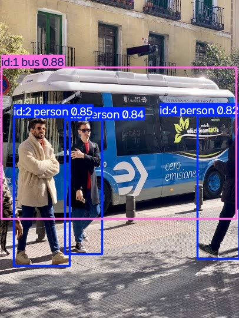
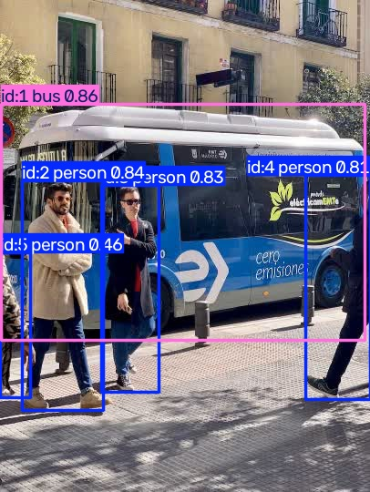
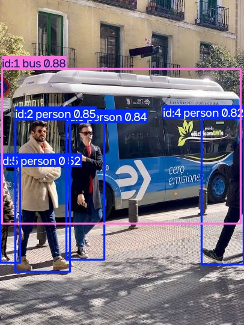

# T08：短影片追蹤，檢查跨影格 ID

**補裝 lap 後，TrackTrack 與 ByteTrack 均跑通，獨立程序重跑結果相同。** 首次自動安裝失敗，完整錯誤已保存。這是靜態影片的流程驗證，不能用來評比追蹤品質。

回到 [結果總覽](../README.md)。下一項為 T09 匯出。

## 範圍、來源與環境

- 查閱、執行日期：2026-10-28。來源：[官方 Track Quick Start](https://docs.ultralytics.com/modes/track/)，本機 `docs/en/modes/track.md`，快照 `9662a727384611b7c28c2428ac252b7d57329b47`。
- 沿用 T01 uv 環境：Windows 11、PowerShell、Intel Core Ultra 7 265H、Python 3.13.14、uv 0.11.23、torch 2.14.1+cpu、PyPI ultralytics 8.4.191，非 editable。本次新增 lap 0.5.13。
- 使用原始 `yolo26n.pt`，不是 T06 訓練模型。輸入沿用 [T04](T04.md) 的 bus 圖片重複影片：406×540、5 FPS、10 幀、2 秒。
- 原例使用 YouTube、`show=True`。本次改成本機短片、`show=False`、CPU、`stream=True`、`save=True` 及明確輸出目錄；因此原文逐字執行未驗證。兩種追蹤器分別建立模型，避免前一個 tracker 的狀態干擾比較。

<a id="t08-a"></a>

## T08-A：預設 TrackTrack

流程：讀取 [輸入 AVI](T08-assets/input/short.avi) → 載入模型 → 逐幀追蹤 → 讀取 `boxes.id`、類別、座標 → 保存影片 → 重新解碼檢查幀數。

核心呼叫見 [完整腳本](T08-assets/logs/t08.py)：

```python
results = model.track(source="t04/short.avi", stream=True, save=True,
                      show=False, device="cpu", project=str(out), name="default")
```

預期：影片可以解碼，結果包含 ID，輸出影片保留全部影格。實際：安裝版預設確實為 `tracktrack.yaml`；10 幀均為 ID 1–4，對應 bus、person、person、person。輸出重新解碼得到 10 幀、5 FPS。

| 第一幀（索引 0） | 最後一幀（索引 9） |
| --- | --- |
|  |  |

[輸出 AVI](T08-assets/output/default.avi)。標籤 `id:1 bus` 表示這次追蹤中的編號，不是人物或車輛的永久身分。影片是重複影格，ID 穩定只證明這個簡單輸入的流程成功。

<a id="t08-b"></a>

## T08-B：切換 ByteTrack

相同輸入與參數，加入 `tracker="bytetrack.yaml"`。10 幀均為 ID 1–5，對應 bus 與 4 個 person；輸出同樣為 10 幀、5 FPS。

| 第一幀 | 最後一幀 |
| --- | --- |
|  |  |

[輸出 AVI](T08-assets/output/bytetrack.avi)、[逐幀 ID／類別／座標 JSON](T08-assets/logs/results.json)。類別 5 是 bus、0 是 person；frame 從 0 開始。

偵測框不一定都會成為追蹤框。兩個 tracker 有不同初始化與配對規則；本次保存的預設設定中，TrackTrack 的 `new_track_thresh` 為 0.7，ByteTrack 為 0.25。這是理解數量差異的線索，沒有只改門檻做隔離實驗，不能宣稱唯一原因已確認，也不能由框數判定哪個較好。

## 錯誤、警告與調整

| 步驟 | 實際結果 | 判斷與處理 |
| --- | --- | --- |
| 首次 track | 缺 `lap>=0.5.12`；AutoUpdate 兩次出現 `cp950 codec can't decode byte 0xe5`，最後 `ModuleNotFoundError: No module named 'lap'` | 追蹤前即失敗，退出碼 1，29.17 秒；保留 [完整日誌](T08-assets/logs/failed-track.log) |
| 手動 uv 安裝 | 連線 PyPI 遭 os error 10013 | 沙箱網路限制；[日誌](T08-assets/logs/failed-install-lap.log)，退出碼 2 |
| 允許網路後，以相同 uv 指令安裝 | 下載約 1.4 MiB，安裝 lap 0.5.13，退出碼 0 | [安裝日誌](T08-assets/logs/failed-install-lap-online.log)；檔名前綴代表保存在首次失敗目錄，不代表這次安裝失敗 |
| 新程序執行兩種 tracker | 退出碼 0，8.03 秒 | [日誌](T08-assets/logs/track.log)、[耗時](T08-assets/logs/execution.json)；無 WARNING |
| 再開新程序及獨立目錄 | 退出碼 0，7.07 秒 | [重跑日誌](T08-assets/logs/repeat-track.log)；無 WARNING；全部 ID、類別、座標 JSON 完全相同 |

安裝版 `check_requirements` 使用 `subprocess.check_output(..., text=True)`，未明確指定解碼方式。此次能確認自動安裝的錯誤訊息被解碼錯誤遮住；另一次手動安裝確認有網路限制，但未保存自動安裝的原始位元組，不能斷言兩者的底層訊息完全相同。

PowerShell 把 uv 的 stderr 包裝為 `NativeCommandError`，連成功安裝日誌也帶有這個外框；因此應一起看退出碼與實際安裝結果，不能只看到紅字就判定失敗。研究讀檔時曾省略 `-Encoding utf8`，造成終端中文亂碼，重新指定編碼後可讀；沒有因此改寫原檔。

教學主流程可跑通，但乾淨環境第一次追蹤會多出依賴安裝步驟。檢查 `boxes.id is not None` 後再讀 ID；本次每幀有 ID，沒有測到無追蹤物件的分支。追蹤器選項、不同門檻及輸出結果均須一起看，不能把 ID 當成原始偵測類別。

## 在本機重跑

```powershell
$repo = 'D:\tools\ultralytics\.worktrees\contribution-research'
$runRoot = Join-Path $env:TEMP 'ultralytics-tutorial-0d928fdb911d405f850a79ca00613d55'
Set-Location $runRoot
$env:UV_CACHE_DIR = Join-Path $env:TEMP 'ultralytics-validation-uv-cache'
$env:YOLO_CONFIG_DIR = Join-Path $runRoot 'config'
$env:PYTHONIOENCODING = 'utf-8'
$python = Join-Path $runRoot '.venv\Scripts\python.exe'
uv pip install --python $python 'lap==0.5.13'
if ($LASTEXITCODE -ne 0) { throw 'lap 安裝失敗，先處理網路或套件錯誤' }
if (!(Test-Path 't04/short.avi') -or !(Test-Path 'yolo26n.pt')) { throw '先恢復 T04 影片與 T01 模型' }
$out = Join-Path $runRoot ('t08-' + [guid]::NewGuid().ToString('N'))
& $python "$repo\research\tutorial-audit\records\T08-assets\logs\t08.py" $out
if ($LASTEXITCODE -ne 0) { throw "請讀 $out\track.log" }
Get-Content "$out\results.json"
```

腳本拒絕已存在的輸出目錄。執行中日誌寫入檔案；影片位於 `$out/default/short.avi` 與 `$out/bytetrack/short.avi`。原始執行目錄為 `t08`（失敗）、`t08-ready`、`t08-repeat`。重跑共享已安裝套件與模型，但不共享 Python 記憶體狀態。

小型輸入／輸出影片已保存在研究目錄；圖片來源沿用 T04。模型、環境仍在 Temp，可能被清除。展示日誌移除 ANSI 控制碼，個人執行根路徑改為 `<RUN_ROOT>`。[核對結果與輸入 SHA256](T08-assets/logs/verification.json) 可供檢查。

## 貢獻候選與下一步

候選是 Windows 自動安裝輸出的解碼錯誤：受影響者可能看不到真正的安裝失敗原因。負責位置為 `ultralytics/utils/checks.py` 的 `check_requirements`；後續應保留 subprocess 原始輸出，在相同 Windows locale 下最小重現，再決定解碼修正。尚未確認最新 upstream main 或搜尋 issue／PR，先不改產品、不新增 pytest。

追蹤依賴的前置安裝說明可列為文件候選，但這次網路受限屬本機條件，尚不足以認定官方流程普遍有缺陷。

調查依據：[安裝版自動安裝原始碼](T08-assets/logs/installed-source.txt)、[TrackTrack 設定](T08-assets/logs/tracktrack.yaml)、[ByteTrack 設定](T08-assets/logs/bytetrack.yaml)。

下一步 T09：選 Windows CPU 可用的匯出格式，先查依賴，再匯出並重載推論，比較原模型結果。

未驗證：真實運動、遮擋、離場再進場、ID switch 品質、逐幀 `persist=True`、YouTube、GUI、CLI、其他 tracker／任務、ReID、GPU。兩種 tracker 的比較不是效能或準確率排名。
