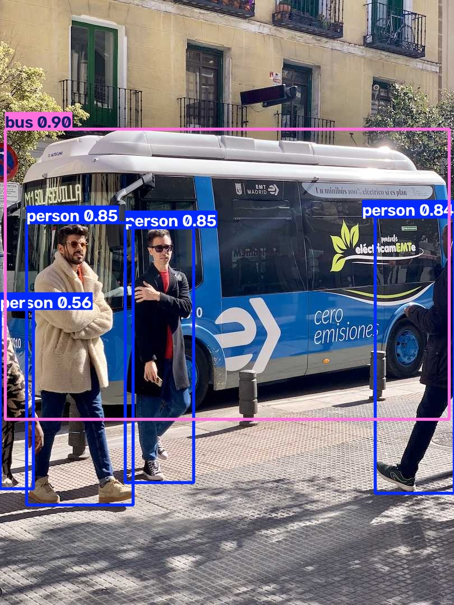

# T09：匯出 ONNX，重新載入並比較預測

**兩輪匯出與重載推論均成功，沒有錯誤或警告。** PyTorch 與 ONNX 都找到 4 人、1 輛巴士；框座標最大差約 0.000183 像素。這是單張圖片的流程與數值核對，不是準確率或效能評比。

回到 [結果總覽](../README.md)。下一項為 T10 Benchmark。

## 範圍與環境

- 來源：[官方 Export](https://docs.ultralytics.com/modes/export/) Usage Examples 的 Python 官方模型選項；本機 `docs/en/modes/export.md`，快照 `9662a727384611b7c28c2428ac252b7d57329b47`。查閱、執行日期：2026-10-28。
- Windows 11／PowerShell、Intel Core Ultra 7 265H、Python 3.13.14、uv 0.11.23、torch 2.14.1+cpu、PyPI ultralytics 8.4.191，非 editable。
- 沿用 T01 的原始 `yolo26n.pt` 與 bus.jpg，不使用 T06 訓練權重。模型 SHA256 見 [結果 JSON](T09-assets/logs/results.json)。
- ONNX 依賴原先均未安裝。本次用 uv 新增 onnx 1.23.2、onnxslim 0.1.98、onnxruntime 1.31.1 及其依賴；[安裝日誌](T09-assets/logs/t09-install.log)、[完整環境快照](T09-assets/logs/t09-requirements.txt)。
- 修改範圍只有本次研究腳本、證據、紀錄與進度索引；沒有修改套件、公開 API 或 pytest。

<a id="t09-a"></a>

## T09-A：匯出模型

流程：用 uv 安裝依賴 → 複製權重到新的輸出目錄 → 載入權重 → 匯出 ONNX → 確認檔案存在且非空。

[完整腳本](T09-assets/logs/t09.py) 的匯出核心：

```python
model = YOLO(out / "yolo26n.pt")
exported = model.export(format="onnx", device="cpu", imgsz=640)
```

原例同時列官方模型與 `path/to/best.pt`，這裡只選官方模型。另指定 CPU、640 尺寸，並預先用 uv 安裝依賴、設定 `YOLO_AUTOINSTALL=False`。因此是適配本機的範例，沒有逐字執行含佔位路徑的整個區塊，也未測自動安裝。

預期：產生可供 CPU runtime 載入的 ONNX。實際：匯出成功，保留預設 `simplify=True`、`dynamic=False`、`quantize=None`、`nms=None`，使用 opset 18。這些設定見 [ONNX metadata](T09-assets/logs/onnx-metadata.json)。opset 是 ONNX 算子版本，本次由匯出器選擇，未手動指定。

| 產物 | 大小 | 位置 |
| --- | --- | --- |
| 複製的 PyTorch 權重 | 5,544,453 bytes | `$out/yolo26n.pt` |
| ONNX 模型 | 9,930,308 bytes | `$out/yolo26n.onnx` |

匯出格式不保證比權重檔小。本次 ONNX 是 FP32；不能把較大的檔案直接當成失敗。

輸出會跟著載入權重的路徑放置。為避免覆寫先前產物，腳本先建立全新目錄並複製權重；沒有套用其他模式的 `project`／`name` 來命名匯出模型。官方參數表已區分 export 的 name 用途，這裡不是文件缺陷。

<a id="t09-b"></a>

## T09-B：新程序重載，與原模型比較

匯出程序結束後，再開 Python 程序。先用 `onnx.checker.check_model` 檢查模型結構，再分別載入 `.pt` 與 `.onnx`，對 [同一張 bus.jpg](T09-assets/input/bus.jpg) 預測並存圖。

```python
model = YOLO(model_path, task="detect")
result = model.predict(
    "bus.jpg", imgsz=640, rect=False, conf=0.25, iou=0.7,
    nms=None, device="cpu", save=True, project=str(out), name=name,
)[0]
```

`rect=False` 讓兩者都使用 640×640 前處理。原圖仍是 1080×810，結果座標已映射回原圖。這與 T02 的預設矩形前處理不同，不能直接拿兩次信心分數比較後歸因於匯出。

| PyTorch 輸出 | ONNX 輸出 |
| --- | --- |
|  |  |

| 檢查項目 | 實測 |
| --- | --- |
| 預測數量／類別順序 | 兩者皆 5 框；bus、person、person、person、person |
| 原圖尺寸 | 兩者皆 1080×810 |
| 最大座標差 | 0.00018310546875 像素 |
| 最大信心分數差 | 0.0000002384185791015625 |
| ONNX 執行後端 | ONNX Runtime 1.31.1，CPUExecutionProvider |
| ONNX 輸入 | `images`，float，`[1, 3, 640, 640]` |
| ONNX 原始輸出 | `output0`，float，`[1, 84, 8400]` |

此 ONNX 原始輸出不是 5 個最終框。它含候選位置與類別分數，Ultralytics 的推論路徑再處理成 `Results`。此次 `nms=None` 的匯出保留供外部 NMS 處理的輸出；直接改用裸 ONNX Runtime 部署時，仍須處理前處理與後處理。這次沒有自行重寫它們。

腳本先確認框數與類別順序一致，再逐列比較座標與分數；assert 要求座標差小於 1 像素、分數差小於 0.001。這是本次檢查門檻，不是官方精度保證；也沒有做多圖的配對或 mAP 評估。

## 錯誤、警告、耗時與重跑

Error：安裝、兩輪匯出及兩輪推論均無；退出碼皆 0。Warning：四份執行日誌均無。匯出器建議 Intel 使用 OpenVINO，是提示，不是失敗。

| 階段 | 首次 | 獨立目錄重跑 |
| --- | --- | --- |
| 匯出子程序（含啟動） | 9.12 秒 | 6.53 秒 |
| PyTorch＋ONNX 推論及檢查子程序 | 7.24 秒 | 6.80 秒 |

首次單張日誌的推論時間為 PyTorch 57.2 ms、ONNX 198.0 ms。沒有做足量暖機、重複測量或執行緒控制，因此不能證明 ONNX 一定較慢，也不能承諾這台電腦會得到加速。效能比較留給 T10。

重跑重新複製權重、匯出模型，再開程序載入；共享 uv 環境與輸入檔，不依賴先前 Python 變數。兩輪預測的座標、類別、分數完全相同。ONNX SHA256 不同，進一步核對發現只有 metadata 的 `date` 不同；在記憶體統一日期後，序列化內容完全一致，未修改原始模型檔。

- 首次：[匯出日誌](T09-assets/logs/export.log)、[推論日誌](T09-assets/logs/predict.log)、[耗時](T09-assets/logs/execution.json)、[完整數值](T09-assets/logs/results.json)。
- 重跑：[匯出日誌](T09-assets/logs/repeat-export.log)、[推論日誌](T09-assets/logs/repeat-predict.log)、[耗時](T09-assets/logs/repeat-execution.json)、[完整數值](T09-assets/logs/repeat-results.json)。
- [比對結果](T09-assets/logs/verification.json)：包含無警告檢查、預測一致性及日期差異。

## 教學順暢度與其他障礙

本次在備妥依賴後能直接完成，沒有新阻塞。前置調整與讀取結果時需要注意：

1. T08 已確認沙箱無法下載 PyPI，本次直接使用允許網路的安裝執行方式，沒有再製造一次已知失敗。自動審核允許安裝；沒有新增永久權限設定。
2. uv 安裝成功日誌仍有 PowerShell `NativeCommandError` 包裝，原因是 stderr 的顯示方式；退出碼 0，套件實際安裝成功。這不是套件安裝失敗。
3. 官方已說明額外依賴可能自動安裝；為符合本機習慣，我們改為明確的 uv 安裝，之後關閉自動安裝。PowerShell 語法是 `$env:YOLO_AUTOINSTALL='False'`。
4. 檔案雜湊、模型預測與效能是不同證據。匯出時間戳造成雜湊不同，不等於模型運算內容不穩定。

## 在本機重跑

```powershell
$repo = 'D:\tools\ultralytics\.worktrees\contribution-research'
$runRoot = Join-Path $env:TEMP 'ultralytics-tutorial-0d928fdb911d405f850a79ca00613d55'
Set-Location $runRoot
$env:UV_CACHE_DIR = Join-Path $env:TEMP 'ultralytics-validation-uv-cache'
$env:YOLO_CONFIG_DIR = Join-Path $runRoot 'config'
$env:PYTHONIOENCODING = 'utf-8'
$env:YOLO_AUTOINSTALL = 'False'
$python = Join-Path $runRoot '.venv\Scripts\python.exe'
uv pip install --python $python 'onnx==1.23.2' 'onnxslim==0.1.98' 'onnxruntime==1.31.1'
if ($LASTEXITCODE -ne 0) { throw '先處理依賴安裝錯誤' }
if (!(Test-Path 'yolo26n.pt') -or !(Test-Path 'bus.jpg')) { throw '先依 T01 恢復模型與圖片' }
$out = Join-Path $runRoot ('t09-' + [guid]::NewGuid().ToString('N'))
& $python "$repo\research\tutorial-audit\records\T09-assets\logs\t09.py" $out
if ($LASTEXITCODE -ne 0) { throw "請檢查 $out 的 export.log 與 predict.log" }
Get-Content "$out\results.json"
```

腳本拒絕既有輸出目錄，執行中日誌寫入檔案。原始產物在 `$runRoot/t09` 與 `t09-repeat`；圖片在各自的 `pytorch/bus.jpg`、`onnx/bus.jpg`。研究目錄保存輸入圖、輸出圖、腳本與日誌；模型仍在 Temp，清除後需重新匯出。

展示日誌去除 ANSI 控制碼，個人執行根目錄替換成 `<RUN_ROOT>`，沒有省略錯誤。metadata 的訓練路徑來自官方權重，不是本機必須存在的資料路徑。輸入圖來源沿用 T01。

## 貢獻候選與下一步

本次沒有確認需要上游修正的 bug。依賴、匯出位置與前處理比較已在本紀錄說明；尚未證明官方缺少關鍵資訊，因此不為了產生 PR 而新增重複文件或測試。未進行 issue／PR 查重或最新 upstream main 重現。

下一步 T10：先讀 Benchmark 範例，限定已具備依賴的格式，在相同資料與尺寸下比較；記錄暖機、驗證指標、耗時及不支援／跳過項目。

未驗證：CLI、自訂訓練模型、其他格式、dynamic、FP16／INT8、內嵌 NMS、GPU、裸 Runtime 部署、多圖品質與正式效能。未執行 pytest。
