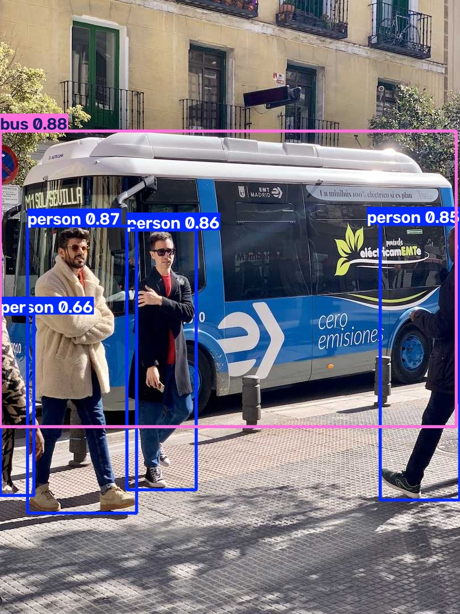

# T11：依 notebook 順序跑本機 CPU 流程

**選定的 6 個儲存格經本機調整後跑通；TorchScript 有棄用警告。** 本次使用腳本依序呼叫 CLI／Python，沒有啟動 Jupyter kernel，因此不能稱為整份 notebook 原樣執行成功。

回到 [結果總覽](../README.md)。

## 來源、環境與輸入

- 來源：[本機 notebook](../../../examples/tutorial.ipynb)，快照 `9662a727384611b7c28c2428ac252b7d57329b47`；查閱與執行日期 2026-10-28。本次未核對即時 upstream main。
- Windows 11、PowerShell、Intel Core Ultra 7 265H、CPU；沿用 uv 0.11.23、Python 3.13.14、torch 2.14.1+cpu、PyPI ultralytics 8.4.191。沒有改成 editable，也沒有新增依賴。[依賴快照](T09-assets/logs/t09-requirements.txt)。
- 原始 yolo26n.pt、COCO8（4 張訓練圖／4 張驗證圖）、已下載 bus.jpg，以及套件內附 zidane.jpg。圖片網址改成本機檔案，這輪沒有驗證 URL 下載。
- [逐格原文](T11-assets/logs/cells.json) 保存 36 格，以下使用 **從 0 開始的索引**；一般介面第 3 格即本紀錄 cell 2。

## 每格執行狀態

| cell | 原文內容 | 本輪處理與結果 |
| --- | --- | --- |
| 0、1、3、5、6、9、12、14、16、17、19、21、23、25、27、29、31 | 說明、連結、圖片、格式表 | 已閱讀；不是可執行程式，未逐一開啟外部連結 |
| 2 | uv 安裝、import、checks | 沿用既有 uv 環境；安裝行未重跑，import／checks 成功 |
| 4 | zidane 網址 CLI 預測 | 改本機 zidane、指定 CPU／輸出名稱；成功 |
| 7 | 下載 COCO val，原文標示 780 MB／5000 圖 | 未執行；本輪沿用 COCO8 |
| 8 | coco.yaml 驗證 | 改 coco8.yaml、CPU、workers=0；成功，不能代表完整 COCO 指標 |
| 10 | TensorBoard／W&B、IPython magic | 未執行；隔離設定關閉兩個 logger，未安裝／啟動服務 |
| 11 | CLI COCO8 訓練 3 epochs | 保留 3 epochs、imgsz=640；加 CPU、workers=0、輸出名稱；成功 |
| 13 | 原始模型匯出 TorchScript | 加 CPU；成功，有 2 項 FutureWarning |
| 15 | Python 建模→訓練→驗證→預測→ONNX | 保留次序與 3 epochs；本機 bus、CPU、workers=0、獨立輸出；成功 |
| 18 | Detection 再訓練與預測 | 未執行；與 cell 15 重疊，但不以其他格結果冒充此格通過 |
| 20、22、24、26、28、30 | segment、semantic、depth、classify、pose、obb | 未執行；另排任務輪次，需各自權重／資料與結果檢查 |
| 32、33 | 安裝 main、clone、editable 安裝 | 未執行；會改變目前固定版環境 |
| 34 | pytest | 未執行；需專用 cwd／權重目錄，不能與教程產物混放 |
| 35 | n/s/m/l/x 完整 COCO 驗證 | 未執行；本輪未下載其餘模型及完整資料 |

這些未執行格是範圍選擇，不表示 Windows 不支援。原文完整流程未執行；本輪驗收的是列出的本機調整版。

<a id="t11-a"></a>

## T11-A：CLI 預測、驗證、訓練與匯出

流程：檢查環境 → 本機 zidane 預測 → 原始模型驗證 → COCO8 訓練 3 epochs → 原始模型匯出 TorchScript。完整命令與每格退出碼、耗時保存在 [execution.json](T11-assets/logs/execution.json)，可直接執行的版本為 [t11.py](T11-assets/logs/t11.py)。

| 輸入 | 實際輸出 | 如何讀 |
| --- | --- | --- |
| zidane.jpg＋原始模型 | 2 persons、1 tie，共 3 框 | 類別與信心值畫在圖片上 |
| 原始模型＋COCO8 val | mAP50–95 約 0.669 | 只有 4 張圖，不是完整 COCO 成績 |
| 原始模型＋COCO8 train、3 epochs | best.pt、last.pt、[逐輪 CSV](T11-assets/logs/cli-train.csv) | 完成訓練流程，不代表模型品質已足夠 |
| 原始模型＋format=torchscript | yolo26n.torchscript；額外重載後仍有 3 框 | 此檔不是前一格的訓練模型 |

| 輸入 | 預測輸出 |
| --- | --- |
|  |  |

日誌：[環境](T11-assets/logs/cell02.log)、[預測](T11-assets/logs/cell04.log)、[驗證](T11-assets/logs/cell08.log)、[訓練](T11-assets/logs/cell11.log)、[TorchScript](T11-assets/logs/cell13.log)。

<a id="t11-b"></a>

## T11-B：Python 同一個 model 的狀態變化

cell 15 先建 `YOLO('yolo26n.yaml')`，下一行立即以預訓練模型覆蓋變數。實際訓練走的是預訓練模型；前面的從零建模並未拿來訓練。

接著 `model.train()` 訓練 3 epochs，`model.val()` 使用訓練後的模型與記住的資料設定。本次獨立驗證 mAP50–95 為 **0.6807541433**，bus 預測有 **5 框（4 人、1 巴士）**。最後 `model.export(format='onnx')` 產生 `python/train/weights/best.onnx`，與 cell 13 的原始模型不同。

每行 `results = ...` 都會覆蓋前一行；訓練／驗證的指標物件、預測的 Results 清單與匯出的路徑，不是同一種回傳值。腳本把它們分開保存，便於檢查。

| 輸入 | 訓練後預測 |
| --- | --- |
|  |  |

另存 [訓練曲線](T11-assets/output/train-results.png)、[逐輪 CSV](T11-assets/logs/python-train.csv)、[驗證標註](T11-assets/output/val-labels.jpg)、[驗證預測](T11-assets/output/val-pred.jpg)、[完整日誌](T11-assets/logs/cell15.log) 與 [數值摘要](T11-assets/logs/summary.json)。框欄位依序為 x1、y1、x2、y2、confidence、class；座標單位是原圖像素。

額外重載 ONNX 成功，同樣 5 框。但原生推論為 640×480，靜態 ONNX 為 640×640，不能把框座標差異直接歸因於匯出誤差。本輪只檢查重載可用；同前處理的比較見 [T09](T09.md#t09-b)。

## 錯誤、警告與教學卡點

- Error：選定執行步驟沒有阻塞錯誤。
- Warning：cell 13 的 `torch.jit.trace`、`torch.jit.trace_method`，以及額外重載的 `torch.jit.load` 各有 FutureWarning，指出介面已棄用。匯出與重載仍成功；不能據此宣告目前格式已無法使用。原始訊息保留在日誌。
- `!`、`%load_ext`、`%tensorboard` 是 notebook／IPython 語法，不能直接貼進一般 `.py` 或 PowerShell。本輪用 subprocess 呼叫指定 uv 環境的 yolo.exe／python.exe，未驗證 notebook kernel 綁定。
- cell 2 文字寫 pip，程式使用 uv；本輪沒有重建 Colab，也沒有證據證明那裡缺 uv。保留為需實機核對的差異。
- cell 7 寫相對 `datasets`，資料解析還涉及 Settings。腳本沿用既有 datasets_dir，為每輪建立獨立 config 與 runs_dir，避免污染共用設定。
- 本次巡查工具曾在訓練日誌尚未建立時讀檔，也曾把 Windows glob 直接傳給 rg 而失敗；改為等待產物與 `rg -g '*.log'` 後完成檢查。這是研究操作問題，不是教程錯誤。

## 重跑方式與證據位置

在 T01／T06／T09 的環境和資料仍在時執行：

```powershell
$repo = 'D:\tools\ultralytics\.worktrees\contribution-research'
$runRoot = Join-Path $env:TEMP 'ultralytics-tutorial-0d928fdb911d405f850a79ca00613d55'
Set-Location $runRoot
$env:PYTHONIOENCODING = 'utf-8'
$env:UV_CACHE_DIR = Join-Path $env:TEMP 'ultralytics-validation-uv-cache'
$python = Join-Path $runRoot '.venv\Scripts\python.exe'
$out = Join-Path $runRoot ('t11-' + [guid]::NewGuid().ToString('N'))
& $python "$repo\research\tutorial-audit\records\T11-assets\logs\t11.py" $out
if ($LASTEXITCODE -ne 0) { throw "查看 $out 的 cell 日誌" }
Get-Content "$out\summary.json"
```

腳本拒絕覆寫既有目錄，替子程序在 import 前指定 YOLO_CONFIG_DIR、關閉自動安裝；每格保存日誌並檢查退出碼，最後檢查 checkpoint、匯出檔與預測物件。沒有另加 pytest。

首次為 `$runRoot/t11`，第二輪為 `t11-repeat`。重跑共享 uv 環境、模型來源與資料快取，使用新的設定／產物目錄和程序，不是全新安裝。展示日誌已去掉 ANSI 控制碼及個人執行根路徑；模型與完整產物仍在 Temp，可能被清除。

兩輪各 6 個子程序退出碼均為 0，合計約 75／79 秒。Python 驗證指標、原生與 ONNX 的 bus 框、TorchScript 的 zidane 框，在對應輪次間逐值相同；三項棄用警告也再次出現。[核對結果](T11-assets/logs/verification.json)、[第二輪命令與耗時](T11-assets/logs/repeat-execution.json)、[第二輪 Python 日誌](T11-assets/logs/repeat-cell15.log)。這不表示不同格式之間的座標相同，也不要求模型檔案雜湊相同。

## 貢獻候選與下一步

目前只有文件候選：在現有 Python Usage 段落補充「train 後的模型狀態、results 型別變化、匯出檔位置」，以及本機執行時的 kernel／環境前提。需先查現有文件、最新版與 issue／PR，確認有普遍缺口再提案。TorchScript 棄用警告屬目前 PyTorch 路徑的觀察，尚未確認需要修改 Ultralytics。

第一輪 T01–T11 的選定案例已走完。下一輪從 Tasks 的 detect 頁補齊與既有案例不同的範例，再依 segment → semantic → depth → classify → pose → obb 前進；不把 notebook 未跑的任務格算成完成。

未驗證：Jupyter／Colab 原樣執行、logger UI、完整 COCO、其他任務、GPU、附錄安裝／pytest、上游查重與正式模型品質。
